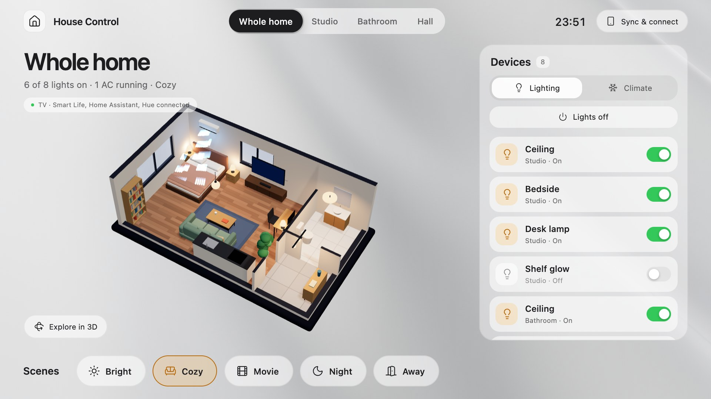
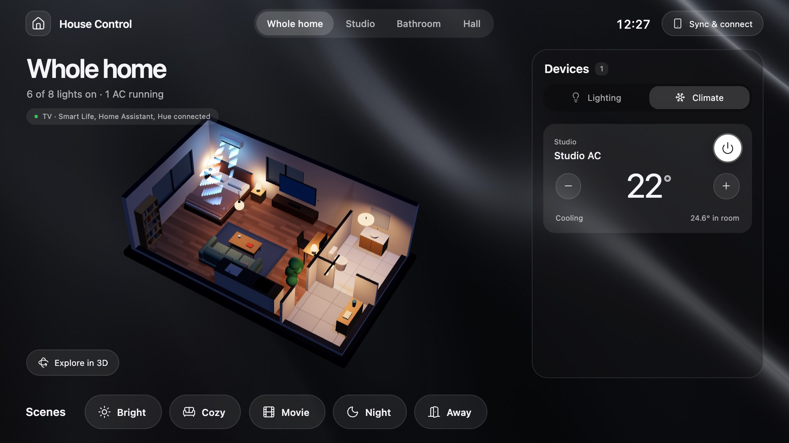
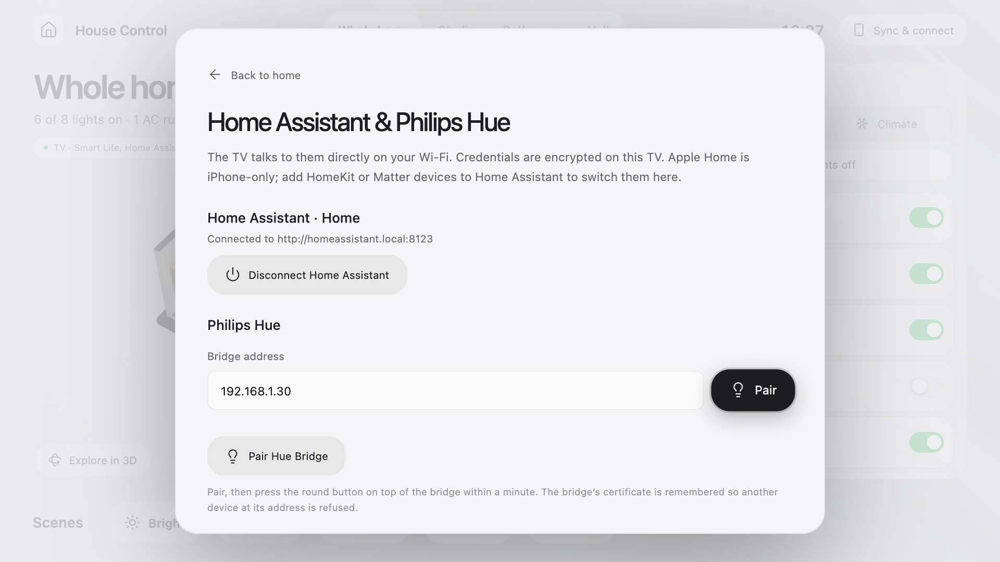
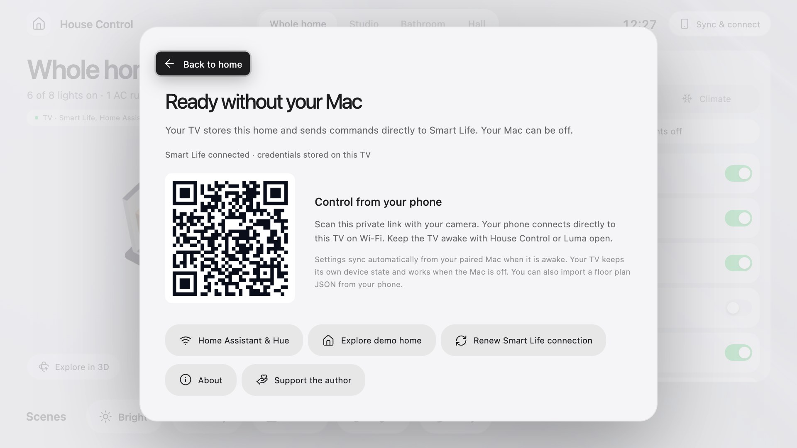
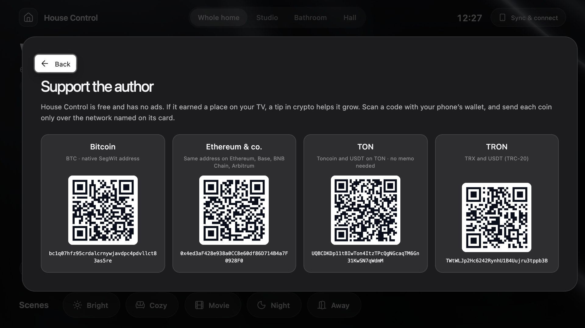
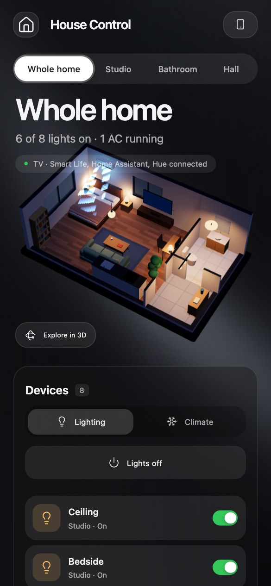

<p align="center">
  
</p>

<h1 align="center">House Control TV</h1>

<p align="center">
  <a href="https://github.com/0xProbabillity/house-control">House Control</a> on your Android TV: your home as a live 3D model,
  its lights, air conditioners and scenes,<br>controlled straight from the TV through Smart Life, Home Assistant and Philips Hue. Your Mac can be off.
</p>

<p align="center">
  <a href="#install"><b>Install</b></a> &nbsp;·&nbsp;
  <a href="#connect-your-devices"><b>Connect your devices</b></a> &nbsp;·&nbsp;
  <a href="#support-the-project"><b>Support the project</b></a>
</p>

<p align="center">
  Made by <a href="https://x.com/0xProbabillity">@0xProbabillity</a>
</p>

## What it does

- **Your home, in 3D, on the big screen.** The same floor plan and renderer as House Control on the Mac and iPhone:
  rooms, furniture, lamps that light the scene. Pick a room to fly to it, or explore the model with the remote.
- **Lights, air conditioners, scenes.** Switch lamps, turn ACs on and off and set their temperature, run your
  scenes. Scenes dim and colour lamps, and only change what is not already right.
- **The TV does it itself.** It keeps its own copy of your home and talks to your devices directly: Smart Life
  with its own sign-in, Home Assistant and Philips Hue over your Wi-Fi. No Mac, no server, no account of ours.
- **Live.** Changes made elsewhere (a wall switch, the Hue app, an automation) show up within a second through Home
  Assistant's and Hue's event streams; Smart Life is read every 12 seconds while the TV is in use.
- **Made for the sofa.** Large type and controls, the rooms in one row at the top, the lights as big rows with
  switches. Pale silver by day and graphite after sunset, worked out for the TV's time zone (no location
  permission); the 3D home floats over it, lit by the sun or the moon. The phone follows its own light or dark mode.
- **Your phone as a remote.** Scan a private QR code on the TV and your phone controls the same home over Wi-Fi.
- **Stays in step with your Mac.** Edit the plan, a device link or a scene in House Control on the Mac and the TV
  has it seconds later. The Mac's Home Assistant and Hue connections come along, so there is nothing to set up twice.
- **On the home screen.** With [Luma](https://github.com/0xProbabillity/luma-tv), the TV's Home shows five round
  scene buttons and your 3D home floating on the wallpaper; *Movie* can dim the lights and open Netflix.
- **Try it without touching anything.** *Sync & connect → Explore demo home* loads a furnished demo loft that has no
  connection to any device.

<p align="center">
  
  
  
  
  <br><sub>Screenshots use the bundled demo home and example addresses.</sub>
</p>

| Platform | How the TV connects |
| --- | --- |
| ✓ **Smart Life / Tuya** | Its own sign-in: scan a QR code with the Smart Life app |
| ✓ **Home Assistant** | Your server's API on your network, with a long-lived access token |
| ✓ **Philips Hue** | The Hue Bridge's local API: press its button once |
| — **Apple Home** | Not on the TV: HomeKit exists only on Apple devices. Add HomeKit or Matter devices to Home Assistant to switch them here |

## Requirements

| | You need |
| --- | --- |
| TV | Android TV or Google TV, Android 8.0 or newer, with network debugging on (Settings → Device Preferences → About: press *Build* 7 times, then Developer options) |
| Your home | A floor plan from [House Control](https://github.com/0xProbabillity/house-control) on a Mac, or a plan JSON file ([format](https://github.com/0xProbabillity/house-control/blob/main/docs/floor-plan.md)) |
| Computer | [ADB](https://developer.android.com/tools/releases/platform-tools) (`brew install --cask android-platform-tools`); the Mac sync needs macOS and Python 3 |
| To build it | Node.js 20.19+, JDK 17, Android SDK build-tools 36.0.0 and platform `android-34`. No Gradle |

## Install

Connect to the TV once (it asks you to allow the computer):

```bash
adb connect 192.168.1.50:5555   # your TV's address: Settings → Network
```

Install `house-control-tv.apk` from [Releases](../../releases) with `adb install -r`, or build it yourself:

```bash
git clone https://github.com/0xProbabillity/house-control-tv.git && cd house-control-tv
./tv.sh install
```

Then give the TV your home:

- **From House Control on a Mac:** `./tv.sh pair` sends the plan saved on this Mac, plus a private key the Mac
  and your phone use to reach the TV. Then `./tv.sh autosync install` keeps the TV in step whenever you save in
  House Control (a user LaunchAgent; `./tv.sh autosync stop` turns it off).
- **Without a Mac:** open the phone companion (below) and import a floor plan JSON.

`./tv.sh status` shows the TV and the installed version; with several devices connected, choose one with
`./tv.sh -s 192.168.1.50:5555 …` or `HOUSE_TV_DEVICE`. The build looks for the Android SDK in `$ANDROID_SDK_ROOT`
and JDK 17 in `$HOUSE_TV_JDK` (defaults: Homebrew's), and creates a signing key in `android/.signing/` the first
time; keep it, so later builds can update the app (`HOUSE_TV_KEYSTORE` chooses a different one). The APK in Releases
is signed with the project's release key, so switching between it and your own build means uninstalling first, which
clears the TV's saved home and sign-ins.

## Connect your devices

Everything is in **Sync & connect** (the button at the top right, or Menu on the remote). Linking a lamp or an AC
of the plan to a real device happens in House Control's editor on the Mac (or in the plan JSON); the TV follows
those links. Devices that are not linked are simulated.

**Smart Life.** Enter the User Code from *Smart Life → Me → Settings → Account and Security*, choose **Show Smart
Life QR**, and scan it with *Smart Life → + → Scan*. The TV gets its own session and renews it by itself; your Mac's
and iPhone's sign-ins are never copied.

**Home Assistant.** In Home Assistant, open your profile → *Security* → *Long-lived access tokens* → *Create
token*. Typing a token with a remote is slow, so open the phone companion and paste the server address (for example
`http://192.168.1.20:8123`) and the token there; they go straight to the TV. Servers on the network are listed by
themselves. `light.*` and `switch.*` entities become lamps (on/off, brightness, white temperature and colour as
their colour modes allow), `climate.*` entities become air conditioners (power, target, and the entity's own mode
and fan names), and temperature sensors can be an AC's room thermometer.

**Philips Hue.** Choose **Pair** next to the bridge (or type the address from the Hue app → *Settings → My Hue
system*), then press the round button on the bridge within a minute. Lamps, Play bars, light strips and plugs work;
the thermometer in a Hue motion sensor can be an AC's room temperature.

With the Mac sync on, Home Assistant and Hue connections made in House Control on the Mac arrive by themselves. A
connection set up on the TV always wins. To keep them on the Mac, install the sync with
`HOUSE_TV_SYNC_CONNECTIONS=0 ./tv.sh autosync install`.

## The phone companion



**Sync & connect** shows a private QR code: scan it with the phone's camera and the phone controls the same home,
connected straight to the TV over Wi-Fi (`./tv.sh phone` opens it on the Mac). The link carries a random key:
anyone who has it can control your devices and replace your plan, so keep it to yourself.

The phone is also the easy way to paste a Home Assistant token or import a floor plan JSON.
<br clear="right">

## With Luma

[Luma](https://github.com/0xProbabillity/luma-tv) shows House Control's scenes and a live 3D preview on the TV's
Home. House Control only answers a Luma signed with a key it trusts: the official Luma release, a Luma built in a
`luma-tv` folder next to this one (your own builds only, not releases), or certificates you list (SHA-256, comma-separated) in `HOUSE_TV_LUMA_CERTS` when
building. Luma never receives a password, token or the phone key.

## Privacy and security

- The plan and device ids stay in the app's private storage; screens, the phone and Luma get a copy without device
  bindings.
- The Smart Life session and the Home Assistant and Hue credentials are encrypted with a non-exportable Android
  Keystore key (`smartlife.enc`, `homeassistant.enc`, `hue.enc`). **Disconnect** deletes them. No status, error or log
  contains a token or bridge key.
- A Home Assistant token over plain `http://` only goes to an address on your home network; `https://` (your own
  domain or Nabu Casa) is checked against the system's certificates. Requests skip any proxy and never follow
  redirects.
- The Hue Bridge's certificate is self-signed: the TV trusts it when pairing, remembers its SHA-256 fingerprint and
  refuses any other device at that address afterwards.
- The TV serves the phone companion and its API on port **8788** of your home network, behind the random key. Do not
  forward that port to the internet.
- Smart Life's cloud is the only internet service involved, plus Philips' bridge discovery when your network blocks
  mDNS. There are no analytics.

## Good to know

- This is not an always-on hub. The TV controls your home while House Control or Luma is open; a sleeping TV, or
  Android closing the app, makes the phone link unavailable until it is opened again. Run automations in Smart
  Life or Home Assistant.
- Air conditioners on the TV: power and target temperature. Modes, fan speeds and the plan itself are edited in
  House Control on the Mac or iPhone.
- An infrared AC's power state is an estimate: its own handheld remote cannot report back.

## Development

```bash
./tv.sh test
```

Runs the Java tests (Smart Life envelope against a Swift CryptoKit vector, device mappings, Home Assistant and Hue
mappings and validation), then the real Home Assistant and Hue clients against [`tools/mock_hubs.py`](tools/mock_hubs.py)
on loopback (pairing, reads, commands, live updates, certificate pinning), then the Mac sync tests.
`python3 tools/mock_hubs.py --host 0.0.0.0 --auto` runs the pretend Home Assistant (port 18123, prints its token)
and Hue Bridge (port 18443) for trying the TV without hardware. The author, links and tip addresses shown in *Sync & connect → About* and
*Support the author* come from [`web/src/support.js`](web/src/support.js).

The interface is the web app in `web/` (Vite, Three.js), shown full screen by a small native Android app in
`android/` that stores the home, talks to the devices and serves the phone companion. The 3D renderer and plan
format come from [House Control](https://github.com/0xProbabillity/house-control) (revision in
`UPSTREAM-REVISION`, license in `UPSTREAM-LICENSE`).

## Support the project

<picture>
  <source media="(prefers-color-scheme: dark)" srcset="docs/support/banner-dark.svg">
  <source media="(prefers-color-scheme: light)" srcset="docs/support/banner-light.svg">
  
</picture>

House Control is free and has no ads. If it earned a place on your TV, a tip in crypto
helps it keep growing: more devices, more platforms, quicker fixes. Thank you! A star, a bug report or a
pull request helps just as much.

Scan a code with your wallet, or copy an address with the button in the corner of its box.

> [!IMPORTANT]
> Send each coin only over the network named next to its address. Coins sent over another network may be lost.

<table>
  <tr>
    <td align="center" width="196">
      
    </td>
    <td>
      &nbsp;
      <b>Bitcoin</b>
      <br><sub>BTC · native SegWit (bech32) address</sub>

```text
bc1q07hfz95crdalcrnywjavdpc4pdvllct83as5re
```

</td>
  </tr>
  <tr>
    <td align="center" width="196">
      
    </td>
    <td>
      
      
      
      &nbsp;
      <b>Ethereum · Base · BNB Chain · Arbitrum</b>
      <br><sub>One address on all four networks · ETH, BNB, USDT, USDC and other tokens</sub>

```text
0x4ed3aF428e938a0CC8e60df86D714B4a7F0928F0
```

</td>
  </tr>
  <tr>
    <td align="center" width="196">
      
    </td>
    <td>
      &nbsp;
      <b>TON</b>
      <br><sub>Toncoin and USDT on TON · no memo needed</sub>

```text
UQBCDKDp11tBIwTon4ItzTPcQgNGcaqTM6Gn31KwSN7qWdmM
```

</td>
  </tr>
  <tr>
    <td align="center" width="196">
      
    </td>
    <td>
      &nbsp;
      <b>TRON</b>
      <br><sub>TRX and USDT (TRC-20)</sub>

```text
TWtWLJp2Hc6242RynhU1B4Uujru3tppb3B
```

</td>
  </tr>
</table>

## Acknowledgements and disclaimer

The Smart Life sign-in follows Tuya's open-source
[`tuya-device-sharing-sdk`](https://github.com/tuya/tuya-device-sharing-sdk), the library behind the Tuya
integration in Home Assistant, as House Control does. The 3D view is built with [Three.js](https://threejs.org); the
icons are from [Lucide](https://lucide.dev), the network logos under [Support the project](#support-the-project)
from [Web3 Icons](https://github.com/0xa3k5/web3icons) (MIT).

This project is not affiliated with or endorsed by Tuya, Smart Life, Home Assistant, Signify (Philips Hue), Google
or Apple. It relies on interfaces these companies can change at any time. Use it at your own risk.

## License

[MIT](LICENSE)
